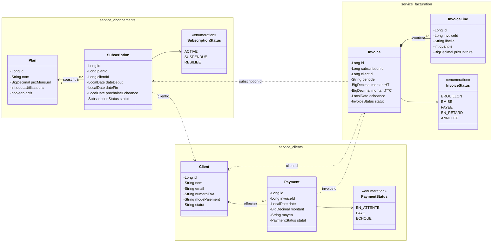
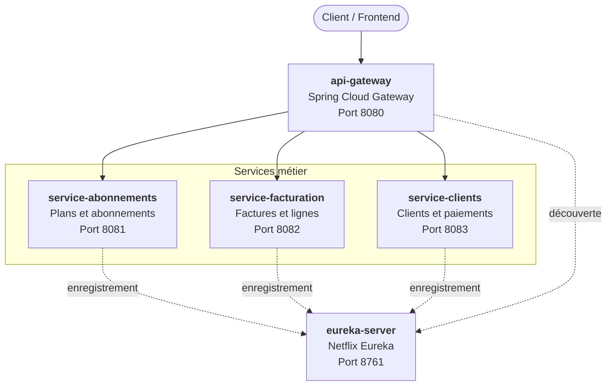

# Bill-Flex

Projet de fin de module (PFM) réalisé par **Othmane Lamdala**, **Hiba Zakari** et **Walid Louane**.

Bill-Flex est une plateforme de **facturation récurrente pour un SaaS B2B**, construite sur une architecture microservices (Java, Spring Boot, Spring Cloud). Au renouvellement mensuel d'un abonnement, une facture est générée selon le plan souscrit, envoyée au client, encaissée, puis relancée automatiquement en cas d'impayé.

L'unité de traitement est la **Facture**, dont le cycle de vie est :

`BROUILLON → EMISE → PAYEE / EN_RETARD → ANNULEE`

> Une facture = 1 abonnement + 1 client + 1 période + 1 montant TTC

Le projet est composé de trois services métier :

| Service | Rôle |
|---|---|
| `service-abonnements` | Catalogue des plans et gestion des abonnements clients |
| `service-facturation` (service principal) | Génération et cycle de vie des factures et de leurs lignes |
| `service-clients` | Comptes clients (entreprises) et paiements |

Ces services sont enregistrés dans un serveur **Eureka** (découverte de services) et exposés via une **API Gateway** (point d'entrée unique).

## Diagramme de classes

Les flèches en pointillés (`..>`) représentent les dépendances entre services, sans préjuger du protocole de communication.

## Architecture de projet

Le projet est composé de cinq applications Spring Boot :

| Application | Rôle | Port |
|---|---|---|
| `eureka-server` | Serveur de découverte de services | **8761** |
| `api-gateway` | Point d'entrée unique, routage vers les services | **8080** |
| `service-abonnements` | Plans et abonnements | **8081** |
| `service-facturation` | Factures et lignes de facturation (service principal) | **8082** |
| `service-clients` | Clients et paiements | **8083** |

## Stack technique

Java 17, Spring Boot 3, Spring Cloud (Eureka, Gateway, OpenFeign), Maven.
