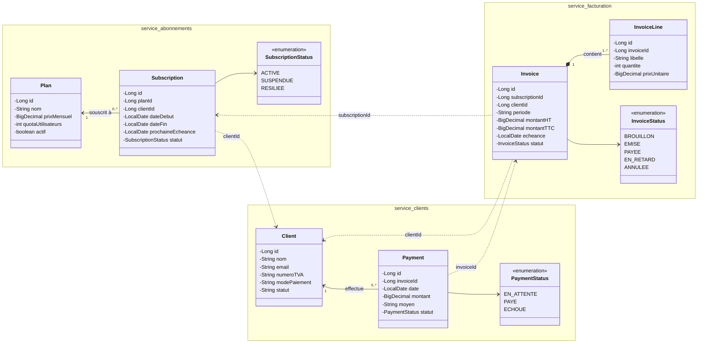
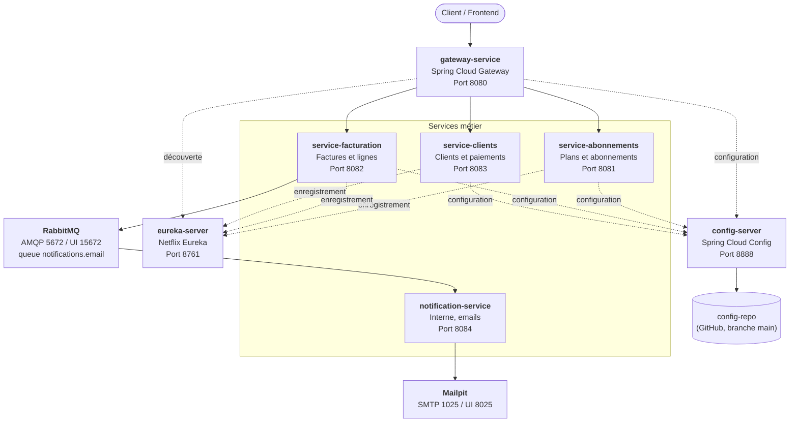

# Bill-Flex

Projet de fin de module (PFM) réalisé par **Othmane Lamdala**, **Hiba Zakari** et **Walid Louane**.

Bill-Flex est une plateforme de **facturation récurrente pour un SaaS B2B**, construite sur une architecture microservices (Java, Spring Boot, Spring Cloud). Au renouvellement mensuel d'un abonnement, une facture est générée selon le plan souscrit, envoyée au client, encaissée, puis relancée automatiquement en cas d'impayé.

L'unité de traitement est la **Facture**, dont le cycle de vie est :

`BROUILLON → EMISE → PAYEE / EN_RETARD → ANNULEE`

> Une facture = 1 abonnement + 1 client + 1 période + 1 montant TTC

Le projet est composé de trois services métier et d'un service interne de notification :

| Service | Rôle |
|---|---|
| `service-abonnements` | Catalogue des plans et gestion des abonnements clients |
| `service-facturation` (service principal) | Génération et cycle de vie des factures et de leurs lignes |
| `service-clients` | Comptes clients (entreprises) et paiements |
| `notification-service` | Consommation des emails RabbitMQ et envoi SMTP Mailpit (interne, non exposé par la Gateway) |

Les trois services métier sont enregistrés dans **Eureka** et exposés via une **API Gateway**. Toutes les applications sont configurées par le **Config Server** (dossier `config-repo`), sauf Eureka et Config Server eux-mêmes. `notification-service` reste interne : il ne s'enregistre pas dans Eureka et n'est pas routé par la Gateway.

## Diagramme de classes

Les flèches en pointillés (`..>`) représentent les dépendances entre services, sans préjuger du protocole de communication.



## Architecture de projet

Le projet est composé de sept applications Spring Boot :



| Application | Rôle | Port |
|---|---|---|
| `eureka-server` | Serveur de découverte de services | **8761** |
| `config-server` | Serveur de configuration centralisée (lit `config-repo`) | **8888** |
| `gateway-service` | Point d'entrée unique, routage vers les services | **8080** |
| `service-abonnements` | Plans et abonnements | **8081** |
| `service-facturation` | Factures et lignes de facturation (service principal) | **8082** |
| `service-clients` | Clients et paiements | **8083** |
| `notification-service` | Notifications email, consommateur interne (pas d'Eureka, pas de Gateway) | **8084** |
| `RabbitMQ` | Broker AMQP, queue durable `notifications.email` | **5672**, UI **15672** |
| `Mailpit` | SMTP local et interface de consultation | **1025**, UI **8025** |

## Configuration centralisée

Le dossier `config-repo/` (versionné sur la branche `main`) contient :

| Fichier | Contenu |
|---|---|
| `application.properties` | Configuration **globale** partagée (URL Eureka, exposition actuator) |
| `service-abonnements.properties` | Port 8081, base H2 `abonnementsdb` |
| `service-facturation.properties` | Port 8082, base H2 `facturationdb` |
| `service-clients.properties` | Port 8083, base H2 `clientsdb` |
| `gateway-service.properties` | Port 8080, routage dynamique |
| `notification-service.properties` | Port 8084, Mailpit et retry RabbitMQ |

Chaque service et la Gateway ne gardent en local que `spring.application.name` et `spring.config.import=configserver:http://localhost:8888`. `eureka-server` et `config-server` gardent leur configuration locale (problème d'amorçage).

Preuve d'agrégation : `GET http://localhost:8888/service-clients/default` renvoie deux `propertySources` : `service-clients.properties` puis `application.properties` (global).

## Démarrage

Ordre de lancement (IntelliJ, une configuration *Spring Boot* par application) :

1. Docker : `docker compose up -d` (ou les commandes `docker run` ci-dessous)
2. `eureka-server` (8761), tableau de bord : http://localhost:8761
3. `config-server` (8888) : http://localhost:8888/service-clients/default
4. `service-abonnements` (8081), `service-facturation` (8082), `service-clients` (8083)
5. `notification-service` (8084), puis `gateway-service` (8080)

Les services et la Gateway refusent de démarrer si le Config Server est injoignable (comportement voulu, *fail-fast*).

Accès aux API via la Gateway (routage dynamique, préfixe = nom du service en minuscules) :

| URL | Service |
|---|---|
| http://localhost:8080/service-abonnements/plans | `service-abonnements` |
| http://localhost:8080/service-abonnements/subscriptions | `service-abonnements` |
| http://localhost:8080/service-facturation/invoices | `service-facturation` |
| http://localhost:8080/service-clients/clients | `service-clients` |
| http://localhost:8080/service-clients/payments | `service-clients` |
| http://localhost:8084/notifications/email | `notification-service` (test manuel direct uniquement) |

### Docker local

```powershell
docker run -d --name mailpit -p 127.0.0.1:1025:1025 -p 127.0.0.1:8025:8025 axllent/mailpit
docker run -d --name rabbitmq -p 127.0.0.1:5672:5672 -p 127.0.0.1:15672:15672 -e RABBITMQ_DEFAULT_USER=tp -e RABBITMQ_DEFAULT_PASS=tp123 -v tp-rabbitmq-data:/var/lib/rabbitmq rabbitmq:4-management
```

Après émission d'une facture (`PATCH /service-facturation/invoices/{id}/emettre`), la facture est sauvegardée puis le message JSON est publié après commit. Le consommateur envoie l'email sans bloquer la réponse HTTP. Arrêter `notification-service`, émettre deux factures, vérifier `Ready = 2` dans RabbitMQ, puis le redémarrer : les deux messages sont alors traités. Mailpit est visible sur http://localhost:8025 et RabbitMQ sur http://localhost:15672 (tp/tp123).

Routage statique (optionnel) : lancer la Gateway avec le profil `statique` (fichier `config-repo/gateway-service-statique.properties`), les chemins sont alors exposés sans préfixe (`/clients`, `/plans`, `/invoices`, ...).

## Stack technique

Java 17, Spring Boot 3.5.6, Spring Cloud 2025.0.0 (Eureka, Gateway reactive, Config Server), Maven.
