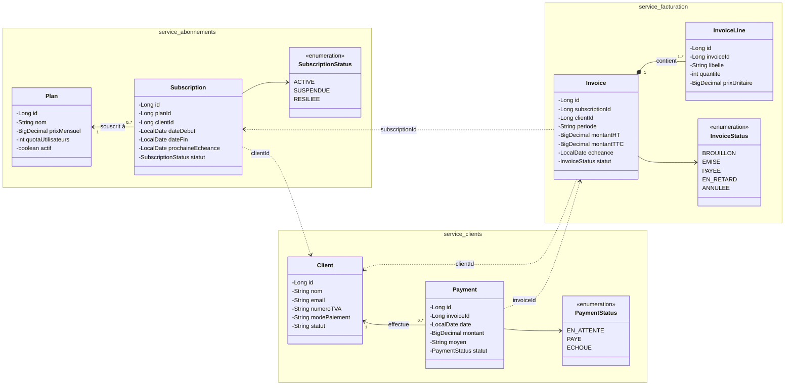
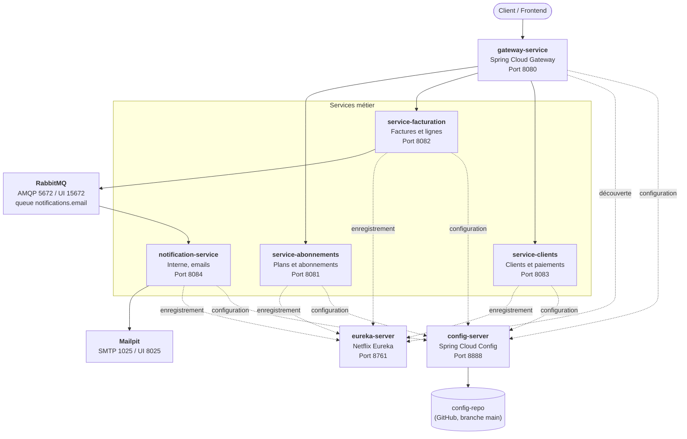

# Bill-Flex

Projet de fin de module (PFM) réalisé par **Othmane Lamdala**, **Hiba Zakari** et **Walid Louane**.

Bill-Flex est une plateforme de **facturation récurrente pour un SaaS B2B**, construite sur une architecture microservices (Java, Spring Boot, Spring Cloud). Au renouvellement mensuel d'un abonnement, une facture est générée selon le plan souscrit, envoyée au client, encaissée, puis relancée automatiquement en cas d'impayé.

L'unité de traitement est la **Facture**, dont le cycle de vie est :

`BROUILLON → EMISE → PAYEE / EN_RETARD → ANNULEE`

> Une facture = 1 abonnement + 1 client + 1 période + 1 montant TTC

Le projet est composé de sept applications Spring Boot et de deux conteneurs d'infrastructure locaux :

| Service | Rôle |
|---|---|
| `service-abonnements` | Catalogue des plans et gestion des abonnements clients |
| `service-facturation` (service principal) | Génération et cycle de vie des factures et de leurs lignes |
| `service-clients` | Comptes clients (entreprises) et paiements |
| `notification-service` | Consommation des emails RabbitMQ et envoi SMTP Mailpit (interne, non exposé par la Gateway) |

Les trois services métier et `notification-service` sont enregistrés dans **Eureka**. La Gateway expose les services métier, mais exclut explicitement `notification-service` du routage dynamique. Toutes les applications sont configurées par le **Config Server** (dossier `config-repo`), sauf Eureka et Config Server eux-mêmes.

## Diagramme de classes

Les flèches en pointillés (`..>`) représentent les dépendances entre services, sans préjuger du protocole de communication.



## Architecture de projet

Le projet est composé de sept applications Spring Boot et de deux conteneurs d'infrastructure :



| Application | Rôle | Port |
|---|---|---|
| `eureka-server` | Serveur de découverte de services | **8761** |
| `config-server` | Serveur de configuration centralisée (lit `config-repo`) | **8888** |
| `gateway-service` | Point d'entrée unique, routage vers les services | **8080** |
| `service-abonnements` | Plans et abonnements | **8081** |
| `service-facturation` | Factures et lignes de facturation (service principal) | **8082** |
| `service-clients` | Clients et paiements | **8083** |
| `notification-service` | Notifications email, enregistré dans Eureka mais exclu du routage Gateway | **8084** |
| `RabbitMQ` | Broker AMQP, queue durable `notifications.email` | **5672**, UI **15672** |
| `Mailpit` | SMTP local et interface de consultation | **1025**, UI **8025** |

## Communication asynchrone (RabbitMQ)

Lorsqu'une facture `BROUILLON` est émise par `PATCH /invoices/{id}/emettre`, `service-facturation` sauvegarde le statut `EMISE`, puis publie après le commit un message JSON dans la file durable `notifications.email`. `notification-service` consomme le message, valide explicitement le DTO et envoie l'email via SMTP à Mailpit. La réponse HTTP n'attend pas l'envoi de l'email.

```mermaid
sequenceDiagram
    participant C as Client
    participant G as Gateway :8080
    participant F as service-facturation :8082
    participant DB as Base de données
    participant R as RabbitMQ :5672
    participant N as notification-service :8084
    participant M as Mailpit SMTP :1025

    C->>G: PATCH /service-facturation/invoices/{id}/emettre
    G->>F: PATCH /invoices/{id}/emettre
    F->>DB: Sauvegarde EMISE
    DB-->>F: Commit
    F->>R: afterCommit - publication JSON notifications.email
    F-->>G: 200 EMISE
    G-->>C: 200 EMISE
    R->>N: Livraison du message
    N->>M: Envoi SMTP
    Note over R,M: Traitement asynchrone; la réponse HTTP n'attend pas l'email
```

## Configuration centralisée

Le dossier `config-repo/` (versionné sur la branche `main`) contient :

| Fichier | Contenu |
|---|---|
| `application.properties` | Configuration **globale** partagée (URL Eureka, exposition actuator et RabbitMQ local) |
| `service-abonnements.properties` | Port 8081, base H2 `abonnementsdb` |
| `service-facturation.properties` | Port 8082, base H2 `facturationdb` |
| `service-clients.properties` | Port 8083, base H2 `clientsdb` |
| `gateway-service.properties` | Port 8080, routage dynamique |
| `notification-service.properties` | Port 8084, Mailpit et retry RabbitMQ |

Chaque service et la Gateway ne gardent en local que `spring.application.name` et `spring.config.import=configserver:http://localhost:8888`. `eureka-server` et `config-server` gardent leur configuration locale (problème d'amorçage).

Le fichier `config-repo/notification-service.properties` contient le port 8084, la connexion SMTP Mailpit, les paramètres de retry RabbitMQ et l'enregistrement Eureka. `config-repo/application.properties` contient l'hôte, le port et les identifiants locaux RabbitMQ (`tp` / `tp123`). Après une modification de `config-repo`, pousser le fichier sur la branche lue par Config Server avant de redémarrer Config Server et les services concernés.

Preuve d'agrégation : `GET http://localhost:8888/service-clients/default` renvoie deux `propertySources` : `service-clients.properties` puis `application.properties` (global).

## Démarrage

Ordre de lancement (IntelliJ, une configuration *Spring Boot* par application) :

1. Docker : `docker compose up -d` (ou les commandes `docker run` ci-dessous)
2. `eureka-server` (8761), tableau de bord : http://localhost:8761
3. `config-server` (8888) : http://localhost:8888/service-clients/default
4. `service-abonnements` (8081), `service-facturation` (8082), `service-clients` (8083)
5. `notification-service` (8084), puis `gateway-service` (8080)

Les services et la Gateway refusent de démarrer si le Config Server est injoignable (comportement voulu, *fail-fast*).

Accès aux API via la Gateway (routage dynamique, préfixe = nom du service en minuscules) :

| URL | Service |
|---|---|
| http://localhost:8080/service-abonnements/plans | `service-abonnements` |
| http://localhost:8080/service-abonnements/subscriptions | `service-abonnements` |
| http://localhost:8080/service-facturation/invoices | `service-facturation` |
| http://localhost:8080/service-clients/clients | `service-clients` |
| http://localhost:8080/service-clients/payments | `service-clients` |
| http://localhost:8084/notifications/email | `notification-service` (test manuel direct uniquement) |

## Docker

Le fichier `docker-compose.yml` existe dans le dépôt. Les commandes équivalentes sont :

```powershell
docker run -d --name mailpit -p 127.0.0.1:1025:1025 -p 127.0.0.1:8025:8025 axllent/mailpit
docker run -d --name rabbitmq -p 127.0.0.1:5672:5672 -p 127.0.0.1:15672:15672 -e RABBITMQ_DEFAULT_USER=tp -e RABBITMQ_DEFAULT_PASS=tp123 -v tp-rabbitmq-data:/var/lib/rabbitmq rabbitmq:4-management
```

Après émission d'une facture (`PATCH /service-facturation/invoices/{id}/emettre`), la facture est sauvegardée puis le message JSON est publié après commit. Le consommateur envoie l'email sans bloquer la réponse HTTP. Arrêter `notification-service`, émettre deux factures, vérifier `Ready = 2` dans RabbitMQ, puis le redémarrer : les deux messages sont alors traités. Mailpit est visible sur http://localhost:8025 et RabbitMQ sur http://localhost:15672 (tp/tp123).

## Tester la notification

Requête métier exacte :

```http
PATCH http://localhost:8080/service-facturation/invoices/{id}/emettre
```

Pour la donnée de démonstration actuelle, l'invoice `3` est `BROUILLON` dans `service-facturation/src/main/resources/data.sql`. Une émission valide retourne `200` avec `statut: "EMISE"`. Le message est ensuite consommé et l'email est visible dans http://localhost:8025.

Pour tester le traitement différé :

1. Arrêter `notification-service`.
2. Émettre deux factures `BROUILLON` et vérifier `200` pour chacune.
3. Ouvrir http://localhost:15672 et vérifier `Ready = 2` dans `notifications.email`.
4. Redémarrer `notification-service`.
5. Vérifier les deux emails dans Mailpit, `Ready = 0` et `Unacked = 0`.

## Gestion des erreurs

| Situation | Résultat |
|---|---|
| Corps invalide ou champs `destinataire`, `objet`, `contenu` invalides sur le endpoint manuel | **400** avec `ApiError` |
| SMTP indisponible sur `POST /notifications/email` | **503** avec `ApiError` |
| Invoice introuvable | **404** |
| Transition invalide, par exemple émission d'une invoice déjà émise | **409**, aucun message publié |
| RabbitMQ indisponible après le commit | **200** pour l'émission, erreur AMQP journalisée par `service-facturation` |
| `notification-service` arrêté | Les messages restent dans la file durable jusqu'au redémarrage |

## Résilience et gestion des erreurs

Les appels Feign de `service-facturation` passent par le bean `ResilientRequests` :

| Appel Feign | Méthode protégée | Résilience |
|---|---|---|
| `ClientsClient.getClient` | `ResilientRequests.getClientStrict` / `getClientFb` | Circuit Breaker, Retry, Bulkhead et timeout Feign |
| `AbonnementsClient.getSubscription` | `ResilientRequests.getSubscriptionStrict` / `getSubscriptionFb` | Circuit Breaker, Retry, Bulkhead et timeout Feign |
| `AbonnementsClient.getPlan` | `ResilientRequests.getPlanFb` | Circuit Breaker, Retry, Bulkhead et timeout Feign |

Configuration réellement déclarée dans `config-repo/service-facturation.properties` : timeouts Feign connect/read **1000/2000 ms**; Retry **3 tentatives au total**, attente **500 ms**, pour `RetryableException` et HTTP 503; l'ordre est Retry → Circuit Breaker → Bulkhead. Les fenêtres Circuit Breaker sont de **6 appels**, minimum **4**, seuil d'échec **50 %**, retour automatique HALF_OPEN et **3 appels** de sonde. L'ouverture dure **10 s** pour `service-clients` et **5 s** pour `service-abonnements`. Les erreurs Feign 4xx sont ignorées par le calcul d'échec du breaker. Le Bulkhead autorise **10 appels simultanés**, sans attente. Les fallbacks stricts journalisent un WARN avec le nom de l'appel et la classe d'exception, sans contenu de requête ni identifiant sensible.

Les endpoints Actuator activés par configuration sont `health`, `info`, `circuitbreakers`, `circuitbreakerevents`, `retries` et `retryevents` :

- http://localhost:8082/actuator/health
- http://localhost:8082/actuator/circuitbreakers
- http://localhost:8082/actuator/circuitbreakerevents
- http://localhost:8082/actuator/retries
- http://localhost:8082/actuator/retryevents

Le circuit `service-abonnements` doit apparaître `OPEN` dans `circuitbreakers` après assez d'échecs. Le starter Spring Cloud CircuitBreaker présent dans le `pom.xml` fournit l'intégration Circuit Breaker, mais son POM publié n'apporte pas `resilience4j-retry`, `resilience4j-bulkhead` ni AOP comme dépendances transitives obligatoires; les dépendances manquantes sont donc déclarées explicitement. Vérification locale demandée : `mvn -pl service-facturation dependency:tree | findstr "resilience4j aop aspectj"`.

Les services exposent un `@RestControllerAdvice` avec le même corps `ApiError` (`timestamp`, `status`, `error`, `message`, `details`) :

| HTTP | Causes couvertes |
|---|---|
| **400** | Validation, corps JSON illisible, paramètre invalide, clé d'idempotence absente ou vide |
| **404** | Facture/client/abonnement introuvable, y compris le 404 Feign |
| **409** | Doublon métier, transition invalide, même clé avec un autre corps, intégrité des données |
| **500** | Erreur inattendue, message neutre côté client et stack trace dans les logs |
| **503** | Service distant indisponible, timeout, circuit ouvert ou Bulkhead saturé |

Les autres erreurs HTTP reçues par Feign sont traduites en **502**; un Feign 409 est traduit en 409.
Le détail de démonstration automatisable est dans [`docs/postman/BillFlex-v6.0.postman_collection.json`](docs/postman/BillFlex-v6.0.postman_collection.json).

## Idempotence des créations

`POST /service-facturation/invoices` et `POST /service-clients/payments` exigent l'en-tête `Idempotency-Key`. Chaque service stocke sa propre clé unique, le SHA-256 du JSON canonique, l'identifiant de ressource et l'instant de création dans la même transaction que la ressource. La réponse initiale est conservée pour restituer le même contenu original lors d'un replay.

- Même clé et même corps : aucune nouvelle ressource; réponse initiale **201**, même identifiant et en-tête `Idempotent-Replayed: true`.
- Même clé et corps différent : **409** avec un `ApiError` explicatif.
- Clé absente ou vide : **400**.
- Échec de validation distante avant sauvegarde (par exemple service-abonnements en panne) : transaction annulée et clé non stockée; la même clé peut être réutilisée après reprise.
- Aucune expiration applicative n'est configurée; avec H2 en mémoire, les clés disparaissent au redémarrage du service.
- La création ou son replay ne publie pas d'email; seule l'émission `PATCH /invoices/{id}/emettre` déclenche le flux V5 après commit.

Exemple :

```http
POST http://localhost:8080/service-facturation/invoices
Idempotency-Key: demo-facture-2026-unique
Content-Type: application/json

{"subscriptionId":3,"clientId":3,"periode":"2030-01","echeance":"2030-02-05","lignes":[{"libelle":"Abonnement","quantite":1,"prixUnitaire":29.00}]}
```

### Démonstration V6

1. **Comportement normal :** dans la collection V6, exécuter A puis B et la vérification de liste. Attendu : deux réponses 201 avec le même identifiant au replay, `Idempotent-Replayed: true`, et une seule facture pour cette période.
2. **Service distant indisponible :** arrêter `service-abonnements`, exécuter F1 et vérifier le 503 `ApiError`; redémarrer le service, exécuter F2 avec la même clé et le même corps. Attendu : 201, création initiale sans indicateur de replay.
3. **Replay de création :** rejouer A avec la même clé/le même corps : 201 et même ID; changer le corps sous cette clé : 409. Dans les deux services, le replay ne crée pas de doublon.

## Captures d'écran

Voir les checklists [`docs/screenshots/README-V5.md`](docs/screenshots/README-V5.md) et [`docs/screenshots/README-V6.md`](docs/screenshots/README-V6.md).

> [À COMPLÉTER : ajouter les captures après la démonstration manuelle.]


Routage statique (optionnel) : lancer la Gateway avec le profil `statique` (fichier `config-repo/gateway-service-statique.properties`), les chemins sont alors exposés sans préfixe (`/clients`, `/plans`, `/invoices`, ...).

## Collections Postman

Les collections sont disponibles dans `docs/postman/`. Elles doivent être exécutées après le démarrage des services indiqués :

| Collection | Scénarios principaux |
|---|---|
| `BillFlex-v1.0.postman_collection.json` | CRUD direct sur les services métier |
| `BillFlex-v2.0.postman_collection.json` | Appels via la Gateway et vérification d'Eureka |
| `BillFlex-v3.0.postman_collection.json` | Agrégation Config Server, accès directs et accès via Gateway |
| `BillFlex-v4.0.postman_collection.json` | Communication OpenFeign entre facturation, abonnements et clients |
| `BillFlex-v5.0.postman_collection.json` | Émission de facture, notifications RabbitMQ et test direct du service email |

La collection V4 doit être exécutée dans l'ordre : elle crée un abonnement de test, puis réutilise son identifiant pour vérifier les appels Feign et les règles de cohérence. Les tests de notification V5 nécessitent RabbitMQ et Mailpit.

## Stack technique

Java 17, Spring Boot 3.5.6, Spring Cloud 2025.0.0 (Eureka, Gateway reactive, Config Server), Spring AMQP, RabbitMQ, Mailpit, Maven.
